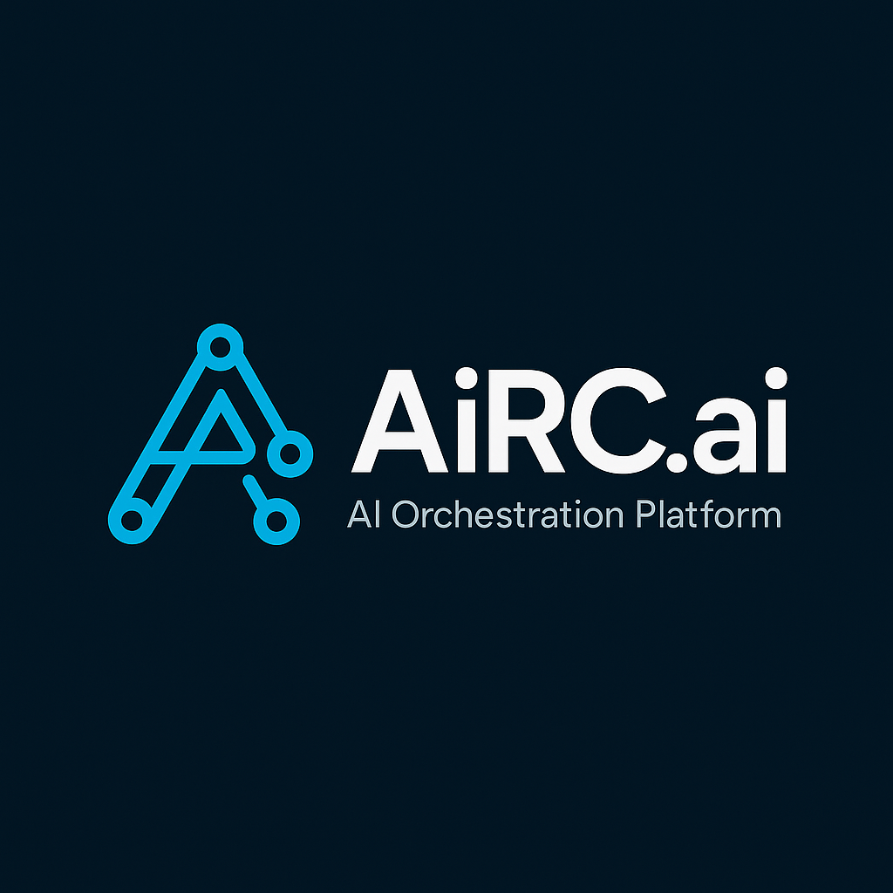
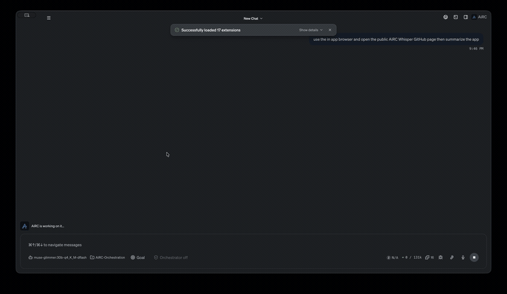
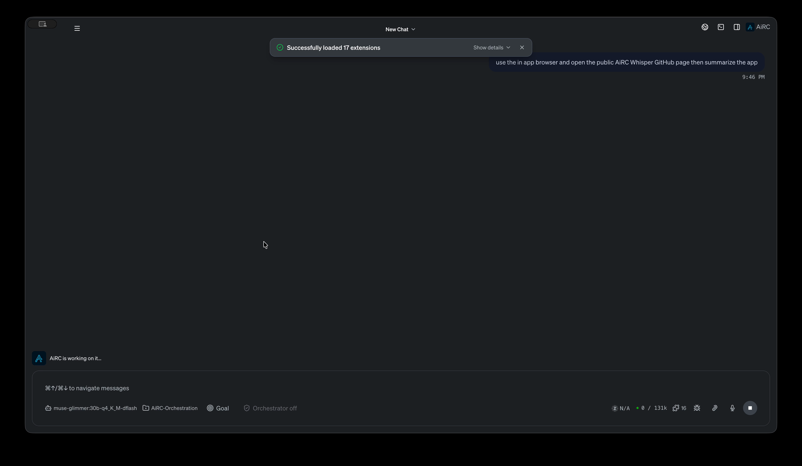
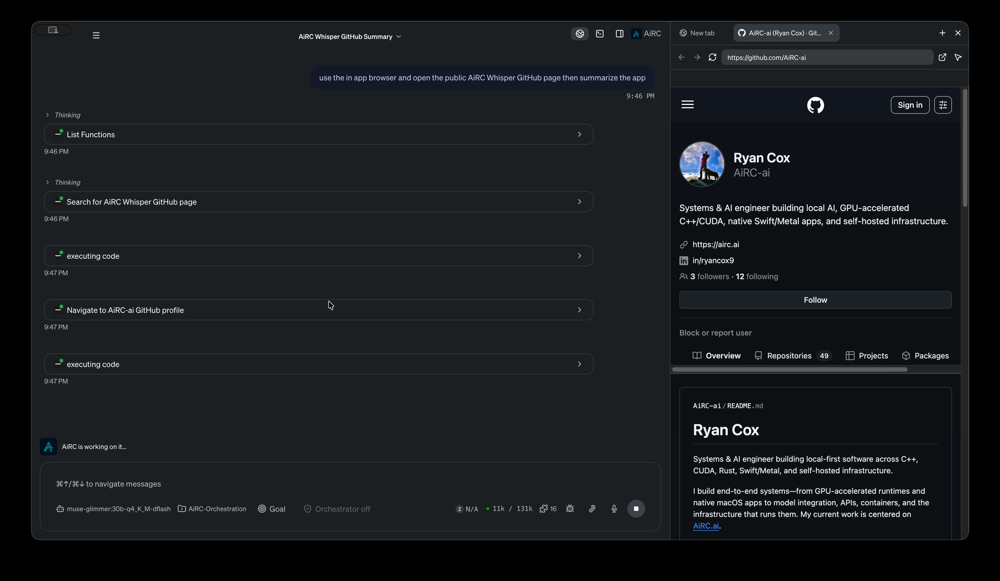
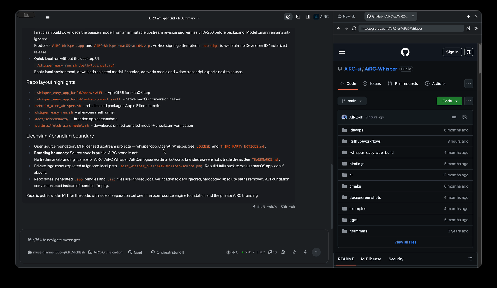

# AiRC Orchestration

  

  <strong>One desktop workspace for AI work that outlasts a single prompt — models, tools, goals, plans, and supervised execution, all tied to your project.</strong>

  
  

  <a href="https://github.com/AiRC-ai/AiRC-Orchestration/releases/latest">Download the latest release</a>
  &nbsp;|&nbsp;
  <a href="https://airc.ai/">AiRC.ai</a>
  &nbsp;|&nbsp;
  <a href="SUPPORT.md">Support</a>

> [!IMPORTANT]
> **AiRC Orchestration is proprietary software.** Features, interfaces, integrations, and packaging may evolve between releases. Download only from this repository's verified [Releases](https://github.com/AiRC-ai/AiRC-Orchestration/releases) page and review the license before use.

Most AI chat tools reset the moment you close the tab. AiRC Orchestration is built for work that takes hours or days — it keeps your project, task, model, tools, goal, plan, and execution evidence connected so an AI workflow can make real progress without losing context.

This repository is the public home for product presentation, release artifacts, installation guides, support, and security reporting. The application source is maintained separately.

## See It In Action

  

  Real session: the <code>muse-glimmer</code> model uses the in-app browser to find, inspect, and summarize the public <a href="https://github.com/AiRC-ai/AiRC-Whisper">AiRC Whisper</a> repository. Every frame was reviewed for private data. <a href="assets/README.md">Capture provenance</a>.

<table>
  <tr>
    <td width="33%"></td>
    <td width="33%"></td>
    <td width="33%"></td>
  </tr>
  <tr>
    <td align="center">One-line browser task</td>
    <td align="center">Live repository inspection</td>
    <td align="center">Detailed architecture summary</td>
  </tr>
</table>

## Why It's Different

### Project-centered work

Tasks, message history, model state, enabled capabilities, and working directory stay tied to the project — no re-explaining context when you come back. Multiple sessions can run concurrently, each with its own model and tool configuration, and the most recent sessions are tracked for quick switching.

### Goals and plans

Give long-running work an explicit objective and track its progress. **Plan Mode** lets the AI explore read-only — reading files, inspecting code, browsing — before making any changes. When the plan is ready, execution begins with the full context already in place.

### Model flexibility

Switch between hosted, local, or remote model providers per session, with model-aware context and reasoning controls. AiRC supports OpenAI-compatible and Anthropic-compatible API formats, with a provider catalog that auto-fills configuration for popular hosted providers. Local inference can run models directly on your machine, and an Inference Mesh mode distributes work across peer nodes.

### Four approval modes

Control how much autonomy the AI has on a per-session basis:

| Mode | Behavior |
| --- | --- |
| **Auto** | Tool calls execute automatically — best for trusted, fast workflows |
| **Smart Approve** | Only sensitive tool calls prompt for approval — the balance point |
| **Approve** | Every tool call asks before executing — full control |
| **Chat** | No tool calls — pure conversation |

### Composable capabilities

Combine tools, extensions, skills, recipes, apps, and automations instead of being locked into one chat surface:

- **Extensions** — MCP-compatible tool servers that add capabilities (file system, shell, browser, databases, APIs)
- **Skills** — Loaded from `SKILL.md` files; extend AiRC with domain-specific instructions
- **Recipes** — Shareable, parameterized workflows encoded as deep links (`airc://recipe?config=...`)
- **Apps** — Applications built by AiRC through chat or imported from shared packages; appear in a grid and launch standalone
- **Automations** — One-time or recurring scheduled work with project and model context attached, managed from plain language

### Supervised execution

Use the optional **Orchestrator** layer to start, monitor, message, and interrupt agent sessions while the main task stays coordinated. The Orchestrator can list active sessions, view their state, send messages to them, and interrupt them — all from within the main chat.

### Bounded delegation

Send focused work to subagents with scoped providers, models, and tools — the main task stays in control. Delegated subagent sessions appear inline with their tool calls and results, and you can jump directly into a subagent's session to inspect what happened.

### Natural-language automation

Create and manage one-time or recurring work from plain-language instructions, with project and model context attached. Automations support cron scheduling, pausing, resuming, and manual run-now. Each run creates a session you can inspect afterward.

### Privacy-first product feedback

AiRC asks before sharing anonymous usage data. The first-party service records
only a small allowlisted set of product events and platform details; it does not
collect conversations, code, prompts, tool arguments, file paths, model names,
account identifiers, or personal data. The preference is off until the user
opts in and can be changed at any time in **Settings > App > Privacy**.

### Integrated work surfaces

Use development tools, terminal workflows, browser work, and computer control where enabled and explicitly permitted:

- **Developer tools** — File editing, shell execution, code analysis
- **In-app browser** — Open and inspect web pages directly inside AiRC; Browser tabs stay scoped to the selected task, and background task workspaces remain hidden until selected
- **Workspace toolbar** — Reach Browser, task context and sub-agent activity, and project terminal controls from the active task while it is loading or running
- **Computer Use** — Native screen and input control on macOS, with user-granted permissions; this is separate from the cross-platform in-app Browser
- **Tunnel access** — Securely connect to AiRC from a mobile device through an encrypted tunnel

### Voice and dictation

Speak instead of type. AiRC supports dictation through multiple providers — OpenAI, ElevenLabs, Groq, and fully local on-device models — with downloadable model management.

Availability depends on the selected model, provider, operating system, configured capabilities, and permissions granted by the user.

## Download

**Release status (October 19, 2026):**
[airc134 is publicly available as a prerelease](https://github.com/AiRC-ai/AiRC-Orchestration/releases/tag/v1.45.0%2Bairc134)
with steering, configured-ratio compaction, and screenshot image-limit fixes.
Further Windows verification is deferred at the maintainer's request, and other
runtime acceptance remains open. `airc121` remains the recommended stable Latest
release; publishing the prerelease does not mark those checks passed or authorize
an automatic rollout. See [airc134 changes and acceptance status](docs/AIRC134.md).

### airc134 Prerelease Downloads

| Platform | Architecture | Download |
| --- | --- | --- |
| macOS | Apple silicon (`arm64`) | [Signed and notarized ZIP](https://github.com/AiRC-ai/AiRC-Orchestration/releases/download/v1.45.0%2Bairc134/AiRC-1.45.0%2Bairc134-macOS-arm64.zip) |
| Windows | x86_64 (`x64`) | [Unsigned Setup installer](https://github.com/AiRC-ai/AiRC-Orchestration/releases/download/v1.45.0%2Bairc134/AiRC-1.45.0%2Bairc134-Setup.exe) |
| Debian-family Linux | x86_64 (`amd64`) | [Debian package](https://github.com/AiRC-ai/AiRC-Orchestration/releases/download/v1.45.0%2Bairc134/airc_1.45.0%2Bairc134_amd64.deb) |

Verify downloads against the release's
[SHA256SUMS](https://github.com/AiRC-ai/AiRC-Orchestration/releases/download/v1.45.0%2Bairc134/SHA256SUMS)
and [manifest](https://github.com/AiRC-ai/AiRC-Orchestration/releases/download/v1.45.0%2Bairc134/release-manifest.json).
Finish running tasks before a manual upgrade and retain a backup and known-good
installer. Windows is intentionally unsigned (`codeSigned: false`).

### Recommended Stable Release

The current recommended macOS Apple silicon, Windows, and Debian-family Linux release is **1.45.0+airc121**. Each published installer ships with checksums,
a machine-readable release manifest, and legal notices on the
[Releases](https://github.com/AiRC-ai/AiRC-Orchestration/releases) page.

The `airc121` release is the latest verified public build. On macOS it reliably triggers the system Local Network permission flow with a bounded startup probe, then stops probing after the permission window closes. The signed and notarized installed app was accepted against a real LAN service from AiRC's own terminal. On Windows, upgrades and uninstall now remove two legacy Start Menu shortcuts left by earlier installers. It carries forward the security protections and application behavior from `airc115`.

It includes the configured sub-agent model choices and restored task-scoped sub-agent activity introduced on the `airc111` line. Before delegation, AiRC supplies each enabled slot's provider, model, reasoning support and levels, context and output limits, attachment and tool capabilities, access policy, route availability, and current global and provider stream capacity. An inherit slot resolves to the task's active provider, model, and reasoning effort. Repeated slots remain distinct choices while sharing the correct process-wide capacity budget. The primary model still assigns every run a task-specific name and purpose, and unavailable routes are rejected before launch. Settings show stable slot IDs, and the model picker remains above its editor instead of rendering behind it.

It retains the project-aware chat workflow, queued follow-up messages while a
task is running, cross-task session messaging, automation refresh while a scheduled run is active, and the
updater, Computer Use, model, provider, long-session, exactly-once-send, goal,
plan, Orchestrator, recovery, and privacy behavior from prior releases.

The updater is available under **Settings > App > Updates**. You can check
manually at any time or enable **Download updates automatically**. AiRC only
accepts update metadata published with the official release, verifies the
declared file size and SHA-512 digest, and offers **Install & Restart** after a
verified download. Automatic downloads can also install safely when AiRC
restarts. See the
[airc121 release notes](https://github.com/AiRC-ai/AiRC-Orchestration/releases/tag/v1.45.0%2Bairc121)
for verification details.

| Platform | Architecture | Download |
| --- | --- | --- |
| macOS | Apple silicon (`arm64`) | [`AiRC-1.45.0+airc121-macOS-arm64.zip`](https://github.com/AiRC-ai/AiRC-Orchestration/releases/download/v1.45.0%2Bairc121/AiRC-1.45.0+airc121-macOS-arm64.zip) |
| Windows | x86_64 (`x64`) | [`AiRC-1.45.0+airc121-Setup.exe`](https://github.com/AiRC-ai/AiRC-Orchestration/releases/download/v1.45.0%2Bairc121/AiRC-1.45.0+airc121-Setup.exe) |
| Debian-family Linux | x86_64 (`amd64`) | [`airc_1.45.0+airc121_amd64.deb`](https://github.com/AiRC-ai/AiRC-Orchestration/releases/download/v1.45.0%2Bairc121/airc_1.45.0+airc121_amd64.deb) |

The macOS `airc121` build is signed with a Developer ID certificate, notarized by Apple, and carries a stapled notarization ticket. The first time a feature connects to a local device or service, macOS may ask for Local Network access. Choose **Allow** when you want AiRC to make that connection; you can review the setting later under **System Settings > Privacy & Security > Local Network**. Windows uses a one-click, per-user installer; this build is intentionally unsigned, so Windows SmartScreen may request confirmation on first launch. The release manifest records that unsigned state explicitly.

Every release includes `SHA256SUMS`, a machine-readable `release-manifest.json`, the AiRC license, the retained Apache license, and third-party notices. macOS releases also include `latest-mac.yml`, which binds the in-app updater to the exact signed and notarized ZIP. See [Installation](docs/INSTALL.md) and [Verify a download](docs/VERIFY.md) before first use.

## How Releases Are Verified

Recommended stable releases must pass the repository's production release gates:

- macOS signing, notarization, stapling, and Gatekeeper acceptance
- Debian package metadata and architecture verification when a Debian installer is included
- Windows PE integrity, checksum, runtime, and Authenticode-state verification when a Windows installer is included
- version, file-name, checksum, and manifest consistency
- clean-install, launch, branding, and upgrade checks
- inspection for private source, credentials, logs, user data, and internal build artifacts

Maintainer details are in [Publishing a release](docs/PUBLISHING.md).
Explicitly authorized public prereleases may retain disclosed runtime gaps;
they are not marked stable/Latest and do not turn pending checks into passes.

## Steering, Context, Images, And Browser Graphics

The [airc134 prerelease](docs/AIRC134.md) addresses blocked steering admission,
compaction delayed until model capacity, and explicit provider image-count
rejections. Steering is accepted during a running reply and delivered at agent
input boundaries; it does not interrupt an in-progress model generation.
Compaction checks the configured ratio before subsequent model rounds. Image
recovery is bounded and preserves saved history and user attachments.

The in-app Browser supports WebGL subject to Chromium, driver, and host graphics
availability. Installed Mac testing rendered verified WebGL1 and WebGL2 pixels
through ANGLE/Metal on an Apple M2 Max. This does not establish hardware GPU
acceleration, WebGL2 support, or performance on every Windows, Linux, VM, or
remote-desktop configuration. A provider's image-count error is not a WebGL error.

Finish or stop your own work before any upgrade that closes AiRC. Do not restart
the app to troubleshoot a browser or provider issue while other tasks are running.

## Using AiRC Responsibly

The current macOS build carries a valid Developer ID signature and an Apple notarization ticket. The Debian and Windows packages are architecture- and integrity-verified with matching checksums; the Windows installer is intentionally unsigned and the release manifest records that state explicitly. Download only from this repository's [Releases](https://github.com/AiRC-ai/AiRC-Orchestration/releases) page — do not install packages offered elsewhere.

- Review model, tool, extension, automation, and operating-system permissions before use.
- Keep approval controls at the narrowest practical level for consequential actions.
- Treat browser and computer-control capabilities as privileged — enable them only when needed.
- Keep important work backed up; interfaces and migration behavior may evolve between releases.
- Never post diagnostics publicly without removing messages, configuration, credentials, private URLs, and personal data.

## Support And Security

- **Product issues** — read [Support](SUPPORT.md) and open an issue.
- **Security vulnerabilities** — follow [Security](SECURITY.md). Do not disclose a vulnerability in a public issue.
- **Product information** — visit [airc.ai](https://airc.ai/).

## License

Original AiRC software, modifications, documentation, release tooling, artwork, and branding are proprietary and governed by the [AiRC Orchestration Proprietary License](LICENSE). Inherited open-source and third-party components retain their respective licenses and notices. See the [license map](LICENSES.md), [NOTICE](NOTICE), [Apache License 2.0](licenses/Apache-2.0.txt), and [third-party notices](THIRD_PARTY_NOTICES.md).
