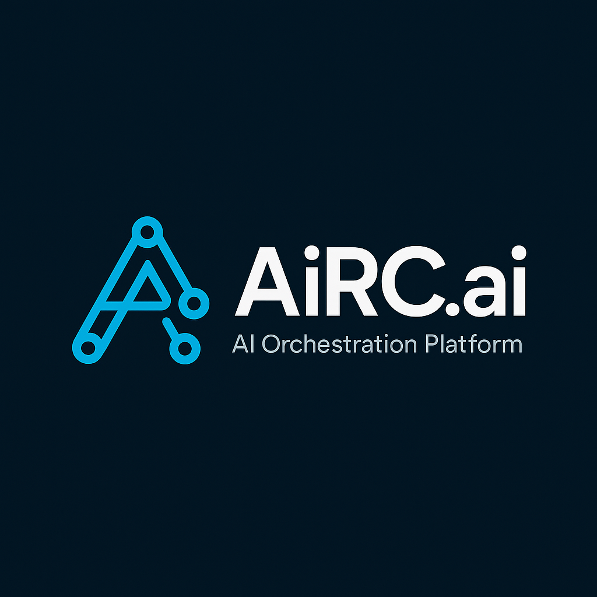
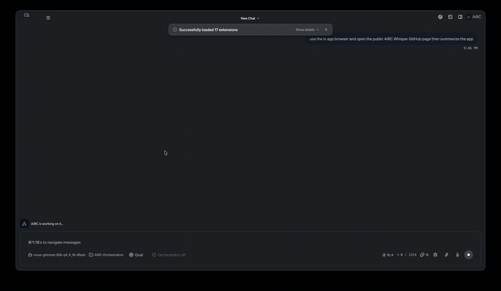
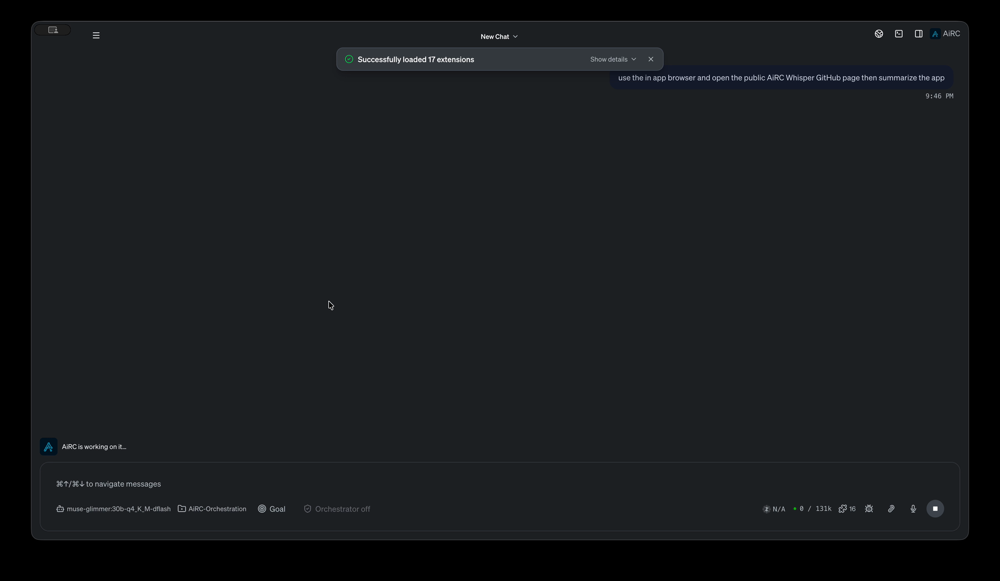
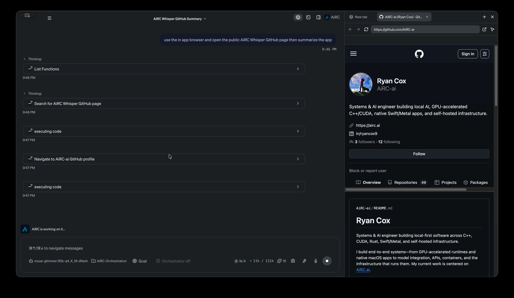
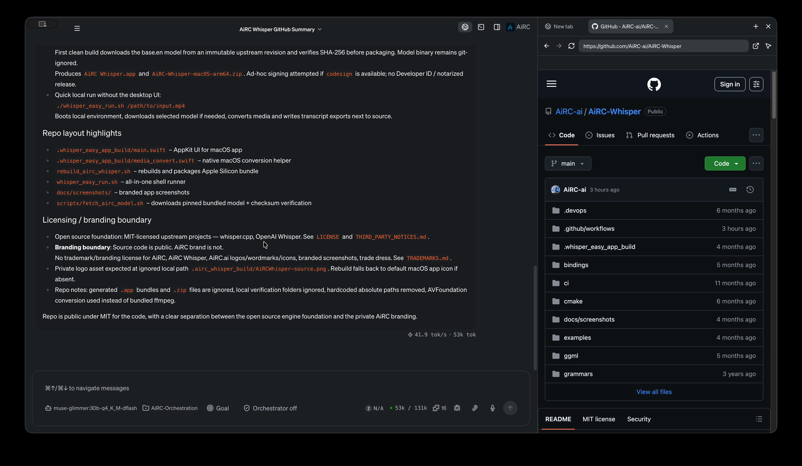

# AiRC Orchestration

  

  <strong>One desktop workspace for AI work that outlasts a single prompt — models, tools, goals, plans, and supervised execution, all tied to your project.</strong>

  
  

  <a href="https://github.com/AiRC-ai/AiRC-Orchestration/releases/latest">Download the latest release</a>
  &nbsp;|&nbsp;
  <a href="https://airc.ai/">AiRC.ai</a>
  &nbsp;|&nbsp;
  <a href="SUPPORT.md">Support</a>

> [!IMPORTANT]
> **AiRC Orchestration is proprietary software.** Features, interfaces, integrations, and packaging may evolve between releases. Download only from this repository's verified [Releases](https://github.com/AiRC-ai/AiRC-Orchestration/releases) page and review the license before use.

Most AI chat tools reset the moment you close the tab. AiRC Orchestration is built for work that takes hours or days — it keeps your project, task, model, tools, goal, plan, and execution evidence connected so an AI workflow can make real progress without losing context.

This repository is the public home for product presentation, release artifacts, installation guides, support, and security reporting. The application source is maintained separately.

## See It In Action

  

  Real session: the <code>muse-glimmer</code> model uses the in-app browser to find, inspect, and summarize the public <a href="https://github.com/AiRC-ai/AiRC-Whisper">AiRC Whisper</a> repository. Every frame was reviewed for private data. <a href="assets/README.md">Capture provenance</a>.

<table>
  <tr>
    <td width="33%"></td>
    <td width="33%"></td>
    <td width="33%"></td>
  </tr>
  <tr>
    <td align="center">One-line browser task</td>
    <td align="center">Live repository inspection</td>
    <td align="center">Detailed architecture summary</td>
  </tr>
</table>

## Why It's Different

### Project-centered work

Tasks, message history, model state, enabled capabilities, and working directory stay tied to the project — no re-explaining context when you come back. Multiple sessions can run concurrently, each with its own model and tool configuration, and the most recent sessions are tracked for quick switching.

### Goals and plans

Give long-running work an explicit objective and track its progress. **Plan Mode** lets the AI explore read-only — reading files, inspecting code, browsing — before making any changes. When the plan is ready, execution begins with the full context already in place.

### Model flexibility

Switch between hosted, local, or remote model providers per session, with model-aware context and reasoning controls. AiRC supports OpenAI-compatible and Anthropic-compatible API formats, with a provider catalog that auto-fills configuration for popular hosted providers. Local inference can run models directly on your machine, and an Inference Mesh mode distributes work across peer nodes.

### Four approval modes

Control how much autonomy the AI has on a per-session basis:

| Mode | Behavior |
| --- | --- |
| **Auto** | Tool calls execute automatically — best for trusted, fast workflows |
| **Smart Approve** | Only sensitive tool calls prompt for approval — the balance point |
| **Approve** | Every tool call asks before executing — full control |
| **Chat** | No tool calls — pure conversation |

### Composable capabilities

Combine tools, extensions, skills, recipes, apps, and automations instead of being locked into one chat surface:

- **Extensions** — MCP-compatible tool servers that add capabilities (file system, shell, browser, databases, APIs)
- **Skills** — Loaded from `SKILL.md` files; extend AiRC with domain-specific instructions
- **Recipes** — Shareable, parameterized workflows encoded as deep links (`airc://recipe?config=...`)
- **Apps** — Applications built by AiRC through chat or imported from shared packages; appear in a grid and launch standalone
- **Automations** — One-time or recurring scheduled work with project and model context attached, managed from plain language

### Supervised execution

Use the optional **Orchestrator** layer to start, monitor, message, and interrupt agent sessions while the main task stays coordinated. The Orchestrator can list active sessions, view their state, send messages to them, and interrupt them — all from within the main chat.

### Bounded delegation

Send focused work to subagents with scoped providers, models, and tools — the main task stays in control. Delegated subagent sessions appear inline with their tool calls and results, and you can jump directly into a subagent's session to inspect what happened.

### Natural-language automation

Create and manage one-time or recurring work from plain-language instructions, with project and model context attached. Automations support cron scheduling, pausing, resuming, and manual run-now. Each run creates a session you can inspect afterward.

### Privacy-first product feedback

AiRC asks before sharing anonymous usage data. The first-party service records
only a small allowlisted set of product events and platform details; it does not
collect conversations, code, prompts, tool arguments, file paths, model names,
account identifiers, or personal data. The preference is off until the user
opts in and can be changed at any time in **Settings > App > Privacy**.

### Integrated work surfaces

Use development tools, terminal workflows, browser work, and computer control where enabled and explicitly permitted:

- **Developer tools** — File editing, shell execution, code analysis
- **In-app browser** — Open and inspect web pages directly inside AiRC; Browser tabs stay scoped to the selected task, and background task workspaces remain hidden until selected
- **Workspace toolbar** — Reach Browser, task context and sub-agent activity, and project terminal controls from the active task while it is loading or running
- **Computer Use** — Native screen and input control on macOS, with user-granted permissions; this is separate from the cross-platform in-app Browser
- **Native companion** — Pair the iPhone or iPad app with your computer over a reachable local or private network; provider credentials and execution remain on the host

### Voice and dictation

Speak instead of type. AiRC supports dictation through multiple providers — OpenAI, ElevenLabs, Groq, and fully local on-device models — with downloadable model management.

Availability depends on the selected model, provider, operating system, configured capabilities, and permissions granted by the user.

## Download

**1.45.0+airc145** adds the host support for the native AiRC 7 companion on iPhone and iPad, along with send recovery, compaction, Stop, and complete desktop history fixes. Read the [release notes and verification scope](docs/AIRC145.md) before upgrading.

| Platform | Architecture | Download |
| --- | --- | --- |
| macOS | Apple silicon (`arm64`) | [Signed and notarized ZIP](https://github.com/AiRC-ai/AiRC-Orchestration/releases/download/v1.45.0%2Bairc145/AiRC-1.45.0%2Bairc145-macOS-arm64.zip) |
| Debian-family Linux | x86_64 (`amd64`) | [Debian package](https://github.com/AiRC-ai/AiRC-Orchestration/releases/download/v1.45.0%2Bairc145/airc_1.45.0%2Bairc145_amd64.deb) |

Verify the exact download with [SHA256SUMS](https://github.com/AiRC-ai/AiRC-Orchestration/releases/download/v1.45.0%2Bairc145/SHA256SUMS) and the [release manifest](https://github.com/AiRC-ai/AiRC-Orchestration/releases/download/v1.45.0%2Bairc145/release-manifest.json). Finish active work and retain a profile backup and known-good installer before upgrading. See [Installation](docs/INSTALL.md) and [Verify a download](docs/VERIFY.md).

The native iOS 7.0.0 update is submitted separately to Apple; desktop publication does not make it available in the App Store. After it becomes available, configure a model on the host, enable companion access in Settings, and scan a fresh pairing QR code directly on the phone. Compare the certificate fingerprint before trusting the host. The computer runs the AI and tools and must remain reachable. Locked-phone push notifications are not enabled in this release. Read the [companion privacy policy](COMPANION_PRIVACY.md).

Previous [airc134](docs/AIRC134.md) and [airc121](https://github.com/AiRC-ai/AiRC-Orchestration/releases/tag/v1.45.0%2Bairc121) installers remain historical references and rollback options with their matching profile backups. Their acceptance scope does not qualify airc145, and older Windows installers do not supply the new companion host features.

The macOS updater is under **Settings > App > Updates**. It verifies the download's declared size and SHA-512 digest against official release metadata before offering **Install & Restart**. Finish active work before restarting. The included `latest-mac.yml` identifies the same signed and notarized ZIP linked above.

## How Releases Are Verified

Production qualification requires the repository's release gates:

- macOS signing, notarization, stapling, and Gatekeeper acceptance
- Debian package metadata and architecture verification when a Debian installer is included
- Windows PE integrity, checksum, runtime, and Authenticode-state verification when a Windows installer is included
- version, file-name, checksum, and manifest consistency
- clean-install, launch, branding, and upgrade checks
- inspection for private source, credentials, logs, user data, and internal build artifacts

Maintainer details are in [Publishing a release](docs/PUBLISHING.md).
Public availability, hosted-file validation, and installed runtime acceptance are separate checks. The [airc145 notes](docs/AIRC145.md) identify the exact source, artifact hashes, completed platform checks, and limits of that evidence.

## Steering, Context, Images, And Browser Graphics

The [airc134 release](docs/AIRC134.md) addresses blocked steering admission,
compaction delayed until model capacity, and explicit provider image-count
rejections. Steering is accepted during a running reply and delivered at agent
input boundaries; it does not interrupt an in-progress model generation.
Compaction checks the configured ratio before subsequent model rounds. Image
recovery is bounded and preserves saved history and user attachments.

The in-app Browser supports WebGL subject to Chromium, driver, and host graphics
availability. Installed Mac testing rendered verified WebGL1 and WebGL2 pixels
through ANGLE/Metal on an Apple M2 Max. This does not establish hardware GPU
acceleration, WebGL2 support, or performance on every Windows, Linux, VM, or
remote-desktop configuration. A provider's image-count error is not a WebGL error.

Finish or stop your own work before any upgrade that closes AiRC. Do not restart
the app to troubleshoot a browser or provider issue while other tasks are running.

## Using AiRC Responsibly

The airc145 macOS build carries a Developer ID signature and an Apple notarization ticket. Its Debian package is architecture- and integrity-verified with matching checksums. Check the manifest for the platforms actually included in each release; historical Windows installers are unsigned. Download only from this repository's [Releases](https://github.com/AiRC-ai/AiRC-Orchestration/releases) page — do not install packages offered elsewhere.

- Review model, tool, extension, automation, and operating-system permissions before use.
- Keep approval controls at the narrowest practical level for consequential actions.
- Treat browser and computer-control capabilities as privileged — enable them only when needed.
- Keep important work backed up; interfaces and migration behavior may evolve between releases.
- Never post diagnostics publicly without removing messages, configuration, credentials, private URLs, and personal data.

## Support And Security

- **Product issues** — read [Support](SUPPORT.md) and open an issue.
- **Security vulnerabilities** — follow [Security](SECURITY.md). Do not disclose a vulnerability in a public issue.
- **Product information** — visit [airc.ai](https://airc.ai/).

## License

Original AiRC software, modifications, documentation, release tooling, artwork, and branding are proprietary and governed by the [AiRC Orchestration Proprietary License](LICENSE). Inherited open-source and third-party components retain their respective licenses and notices. See the [license map](LICENSES.md), [NOTICE](NOTICE), [Apache License 2.0](licenses/Apache-2.0.txt), and [third-party notices](THIRD_PARTY_NOTICES.md).
